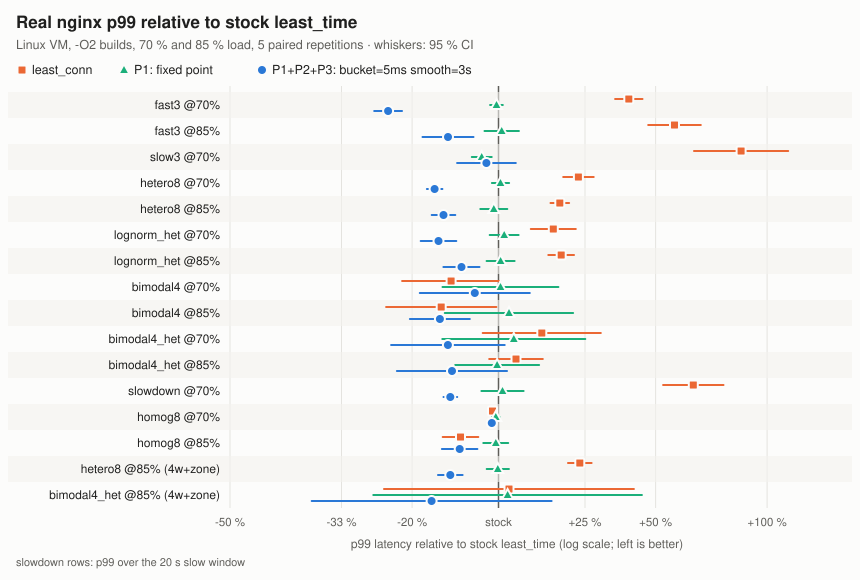

# Real nginx results (Linux)

nginx 1.31 master and the patched trees, `-O2`, no debug logging, one worker unless noted, in a Linux VM (Docker Desktop, linuxkit kernel, 12 vCPUs of an Apple M2 Max). CPU sets: nginx 0-3, backends 4-7, load generator 8-11.

Backends are Go HTTP servers with one FCFS worker each that hold the request for cost/speed ms. The load generator is open loop (Poisson), with latency measured from each request's scheduled send time. It draws every request's cost from the scenario's distribution with seed = repetition and passes it in the URL, so all variants of a repetition see identical arrivals and costs. Variants run in shuffled order inside each repetition. Each run is 5 s warm-up plus 30 s measured (slow3: 90 s, slowdown: 60 s, with p99 over the 20 s slow window).

Load generator send lag (scheduled to actual send), p99 across runs: median 0.03 ms, max 7.81 ms. Errors: 0 in 540 runs. Disturbed runs excluded (send lag p99 over 2 ms and over 3x the median of the same cell): 0.

## p99 change vs stock least_time (paired by repetition, 95 % CI)

| config | scenario | util | n | least_conn | P1: fixed point | P1+P2: bucket=5ms | P1+P2+P3: bucket=5ms smooth=3s | P1+P3: smooth=3s |
| --- | --- | --- | --- | --- | --- | --- | --- | --- |
| 1 worker | bimodal4 | 0.7 | 5 | -12 % [-22, +0] | +1 % [-13, +17] | +6 % [-14, +30] | -6 % [-18, +8] | -13 % [-20, -6] |
| 1 worker | bimodal4 | 0.85 | 5 | -14 % [-25, -1] | +3 % [-13, +21] | -0 % [-16, +17] | -14 % [-20, -7] | -9 % [-23, +8] |
| 1 worker | bimodal4_het | 0.7 | 5 | +12 % [-4, +30] | +4 % [-14, +25] | +3 % [-11, +19] | -12 % [-24, +2] | -16 % [-27, -3] |
| 1 worker | bimodal4_het | 0.85 | 5 | +5 % [-2, +12] | -0 % [-11, +11] | +1 % [-16, +22] | -11 % [-23, +2] | -16 % [-25, -7] |
| 1 worker | fast3 | 0.5 | 5 | +24 % [+19, +30] | -2 % [-8, +3] | -41 % [-43, -38] | -44 % [-46, -42] | -12 % [-15, -9] |
| 1 worker | fast3 | 0.7 | 5 | +40 % [+35, +45] | -1 % [-2, +1] | -21 % [-26, -16] | -25 % [-27, -22] | -7 % [-9, -5] |
| 1 worker | fast3 | 0.85 | 5 | +57 % [+47, +69] | +1 % [-4, +5] | -4 % [-8, +1] | -12 % [-18, -6] | -3 % [-8, +3] |
| 1 worker | hetero8 | 0.5 | 5 | +28 % [+25, +32] | +1 % [-4, +6] | -11 % [-14, -8] | -12 % [-14, -10] | +1 % [-4, +6] |
| 1 worker | hetero8 | 0.7 | 5 | +23 % [+18, +28] | +1 % [-2, +3] | -11 % [-13, -8] | -15 % [-17, -13] | -4 % [-5, -3] |
| 1 worker | hetero8 | 0.85 | 5 | +17 % [+14, +20] | -1 % [-5, +2] | -8 % [-9, -6] | -13 % [-16, -11] | -3 % [-5, -1] |
| 1 worker | homog8 | 0.7 | 5 | -2 % [-2, -1] | -1 % [-2, +0] | -1 % [-2, +1] | -2 % [-3, -1] | -2 % [-3, -1] |
| 1 worker | homog8 | 0.85 | 5 | -9 % [-13, -5] | -1 % [-4, +3] | -7 % [-11, -4] | -10 % [-14, -5] | -1 % [-5, +3] |
| 1 worker | lognorm_het | 0.7 | 5 | +15 % [+9, +22] | +1 % [-2, +5] | -7 % [-11, -2] | -14 % [-18, -10] | -2 % [-7, +4] |
| 1 worker | lognorm_het | 0.85 | 5 | +18 % [+14, +22] | +1 % [-3, +4] | -4 % [-8, -0] | -9 % [-13, -5] | -3 % [-5, -1] |
| 1 worker | slow3 | 0.7 | 5 | +87 % [+66, +111] | -4 % [-7, -2] | +2 % [-4, +7] | -3 % [-10, +5] | -1 % [-6, +4] |
| 1 worker | slowdown | 0.7 | 5 | +65 % [+53, +79] | +1 % [-4, +7] | -6 % [-12, +1] | -12 % [-13, -10] | -5 % [-8, -2] |
| 4 workers + zone | bimodal4_het | 0.85 | 5 | +3 % [-26, +42] | +2 % [-28, +45] | -2 % [-26, +30] | -16 % [-38, +15] | -18 % [-36, +5] |
| 4 workers + zone | hetero8 | 0.85 | 5 | +23 % [+20, +27] | -0 % [-3, +3] | -7 % [-9, -5] | -12 % [-14, -9] | -3 % [-4, -2] |

## Absolute p99 and mean latency (ms, mean ± 95 % CI over repetitions)

### bimodal4 @ 0.7, 1 worker: 4 equal backends; 90 % 2 ms / 10 % 80 ms

| variant | p99 | mean | share by backend (%) |
| --- | --- | --- | --- |
| least_conn | 399.6 ± 44.2 | 41.05 ± 5.13 | 24/25/26/25 |
| least_time (stock) | 454.2 ± 87.0 | 53.09 ± 9.54 | 23/26/26/25 |
| P1: fixed point | 455.4 ± 71.5 | 52.62 ± 9.09 | 24/25/28/24 |
| P1+P2: bucket=5ms | 483.6 ± 115.4 | 56.87 ± 7.79 | 23/26/26/25 |
| P1+P2+P3: bucket=5ms smooth=3s | 426.4 ± 68.7 | 44.00 ± 6.14 | 24/27/25/24 |
| P1+P3: smooth=3s | 394.2 ± 63.8 | 43.20 ± 6.70 | 25/26/24/25 |

### bimodal4 @ 0.85, 1 worker: 4 equal backends; 90 % 2 ms / 10 % 80 ms

| variant | p99 | mean | share by backend (%) |
| --- | --- | --- | --- |
| least_conn | 572.0 ± 103.8 | 83.44 ± 17.84 | 25/26/25/25 |
| least_time (stock) | 667.6 ± 156.2 | 101.14 ± 24.99 | 25/26/25/25 |
| P1: fixed point | 688.5 ± 192.9 | 100.26 ± 21.44 | 25/25/26/24 |
| P1+P2: bucket=5ms | 664.0 ± 156.5 | 105.32 ± 24.65 | 25/24/25/25 |
| P1+P2+P3: bucket=5ms smooth=3s | 574.8 ± 142.6 | 88.15 ± 18.98 | 24/25/24/26 |
| P1+P3: smooth=3s | 608.5 ± 139.6 | 89.70 ± 17.34 | 26/25/23/26 |

### bimodal4_het @ 0.7, 1 worker: 4 backends, speeds 2,1,1,½; 90 % 2 ms / 10 % 80 ms

| variant | p99 | mean | share by backend (%) |
| --- | --- | --- | --- |
| least_conn | 487.2 ± 60.6 | 43.65 ± 5.25 | 39/24/23/14 |
| least_time (stock) | 434.7 ± 33.7 | 46.38 ± 7.80 | 45/23/22/10 |
| P1: fixed point | 454.2 ± 67.3 | 46.41 ± 8.36 | 45/21/24/10 |
| P1+P2: bucket=5ms | 448.9 ± 46.9 | 50.11 ± 6.53 | 46/23/21/9 |
| P1+P2+P3: bucket=5ms smooth=3s | 382.9 ± 56.9 | 38.13 ± 5.72 | 47/23/20/9 |
| P1+P3: smooth=3s | 367.2 ± 41.8 | 38.28 ± 5.50 | 46/22/23/9 |

### bimodal4_het @ 0.85, 1 worker: 4 backends, speeds 2,1,1,½; 90 % 2 ms / 10 % 80 ms

| variant | p99 | mean | share by backend (%) |
| --- | --- | --- | --- |
| least_conn | 785.8 ± 279.1 | 94.12 ± 25.40 | 41/23/23/12 |
| least_time (stock) | 754.3 ± 278.5 | 99.50 ± 30.88 | 46/22/21/11 |
| P1: fixed point | 739.2 ± 188.5 | 100.62 ± 27.29 | 45/22/22/11 |
| P1+P2: bucket=5ms | 755.0 ± 230.0 | 102.74 ± 28.24 | 45/21/23/12 |
| P1+P2+P3: bucket=5ms smooth=3s | 656.4 ± 157.7 | 86.06 ± 24.61 | 46/23/22/9 |
| P1+P3: smooth=3s | 621.1 ± 161.7 | 88.63 ± 27.09 | 46/22/22/10 |

### fast3 @ 0.5, 1 worker: 3 backends, 2/6/15 ms mean

| variant | p99 | mean | share by backend (%) |
| --- | --- | --- | --- |
| least_conn | 61.2 ± 3.1 | 7.69 ± 0.21 | 55/29/15 |
| least_time (stock) | 49.2 ± 1.1 | 6.64 ± 0.16 | 59/30/10 |
| P1: fixed point | 48.0 ± 2.0 | 6.56 ± 0.12 | 59/31/10 |
| P1+P2: bucket=5ms | 29.0 ± 1.2 | 4.89 ± 0.20 | 77/21/3 |
| P1+P2+P3: bucket=5ms smooth=3s | 27.5 ± 1.3 | 4.79 ± 0.17 | 77/20/3 |
| P1+P3: smooth=3s | 43.3 ± 1.7 | 6.21 ± 0.22 | 60/31/9 |

### fast3 @ 0.7, 1 worker: 3 backends, 2/6/15 ms mean

| variant | p99 | mean | share by backend (%) |
| --- | --- | --- | --- |
| least_conn | 83.3 ± 4.2 | 10.29 ± 0.47 | 61/27/12 |
| least_time (stock) | 59.5 ± 2.5 | 8.57 ± 0.27 | 64/27/10 |
| P1: fixed point | 59.2 ± 2.2 | 8.64 ± 0.33 | 63/27/10 |
| P1+P2: bucket=5ms | 47.0 ± 3.2 | 7.44 ± 0.37 | 72/22/6 |
| P1+P2+P3: bucket=5ms smooth=3s | 44.8 ± 2.3 | 7.25 ± 0.30 | 72/22/6 |
| P1+P3: smooth=3s | 55.3 ± 2.9 | 8.34 ± 0.39 | 64/28/9 |

### fast3 @ 0.85, 1 worker: 3 backends, 2/6/15 ms mean

| variant | p99 | mean | share by backend (%) |
| --- | --- | --- | --- |
| least_conn | 136.5 ± 15.1 | 16.82 ± 1.54 | 64/25/11 |
| least_time (stock) | 86.8 ± 12.1 | 13.98 ± 1.48 | 67/24/9 |
| P1: fixed point | 87.4 ± 11.1 | 13.87 ± 1.21 | 67/24/9 |
| P1+P2: bucket=5ms | 83.5 ± 11.0 | 13.27 ± 1.47 | 70/22/7 |
| P1+P2+P3: bucket=5ms smooth=3s | 76.6 ± 16.1 | 12.83 ± 1.35 | 69/23/8 |
| P1+P3: smooth=3s | 84.5 ± 10.9 | 13.70 ± 1.46 | 67/24/9 |

### hetero8 @ 0.5, 1 worker: 8 backends, speeds 2,2,1,1,1,1,½,½; exp 10 ms

| variant | p99 | mean | share by backend (%) |
| --- | --- | --- | --- |
| least_conn | 63.1 ± 0.5 | 10.62 ± 0.12 | 18/18/12/12/12/12/8/8 |
| least_time (stock) | 49.1 ± 1.5 | 9.28 ± 0.12 | 21/21/14/14/13/14/2/2 |
| P1: fixed point | 49.6 ± 2.7 | 9.29 ± 0.15 | 21/21/13/14/13/14/2/2 |
| P1+P2: bucket=5ms | 43.7 ± 2.1 | 8.43 ± 0.48 | 29/29/11/11/8/11/1/1 |
| P1+P2+P3: bucket=5ms smooth=3s | 43.0 ± 1.1 | 8.09 ± 0.16 | 29/29/10/10/9/10/2/1 |
| P1+P3: smooth=3s | 49.7 ± 2.1 | 9.28 ± 0.19 | 21/21/14/14/13/14/2/2 |

### hetero8 @ 0.7, 1 worker: 8 backends, speeds 2,2,1,1,1,1,½,½; exp 10 ms

| variant | p99 | mean | share by backend (%) |
| --- | --- | --- | --- |
| least_conn | 74.4 ± 2.7 | 12.46 ± 0.26 | 19/20/12/12/12/12/7/7 |
| least_time (stock) | 60.5 ± 2.7 | 11.62 ± 0.32 | 22/22/13/12/12/12/4/4 |
| P1: fixed point | 60.9 ± 3.1 | 11.59 ± 0.33 | 22/22/12/12/12/12/4/4 |
| P1+P2: bucket=5ms | 54.1 ± 2.0 | 10.63 ± 0.29 | 25/25/11/11/11/11/3/3 |
| P1+P2+P3: bucket=5ms smooth=3s | 51.3 ± 1.6 | 10.44 ± 0.32 | 26/26/11/11/11/11/3/3 |
| P1+P3: smooth=3s | 57.8 ± 2.6 | 11.43 ± 0.35 | 22/21/12/13/13/13/3/3 |

### hetero8 @ 0.85, 1 worker: 8 backends, speeds 2,2,1,1,1,1,½,½; exp 10 ms

| variant | p99 | mean | share by backend (%) |
| --- | --- | --- | --- |
| least_conn | 96.4 ± 6.4 | 17.27 ± 0.85 | 21/21/12/12/11/12/6/6 |
| least_time (stock) | 82.3 ± 5.1 | 16.62 ± 0.87 | 23/23/11/11/11/11/5/5 |
| P1: fixed point | 81.4 ± 7.6 | 16.62 ± 0.85 | 23/23/11/11/11/11/5/5 |
| P1+P2: bucket=5ms | 76.0 ± 6.0 | 15.62 ± 0.87 | 24/23/11/11/11/11/4/4 |
| P1+P2+P3: bucket=5ms smooth=3s | 71.5 ± 5.9 | 15.14 ± 0.82 | 24/23/11/11/11/11/5/4 |
| P1+P3: smooth=3s | 79.7 ± 6.1 | 16.43 ± 0.76 | 23/23/11/11/11/11/5/5 |

### homog8 @ 0.7, 1 worker: 8 equal backends; exp 10 ms (control)

| variant | p99 | mean | share by backend (%) |
| --- | --- | --- | --- |
| least_conn | 55.6 ± 1.9 | 12.49 ± 0.25 | 12/12/13/13/12/12/13/13 |
| least_time (stock) | 56.5 ± 2.3 | 12.78 ± 0.34 | 12/13/13/13/12/13/13/12 |
| P1: fixed point | 56.1 ± 2.0 | 12.72 ± 0.33 | 13/12/12/12/13/13/13/12 |
| P1+P2: bucket=5ms | 56.2 ± 2.0 | 12.65 ± 0.27 | 13/12/12/12/12/13/13/12 |
| P1+P2+P3: bucket=5ms smooth=3s | 55.5 ± 2.6 | 12.51 ± 0.25 | 12/13/12/13/12/13/13/12 |
| P1+P3: smooth=3s | 55.5 ± 2.0 | 12.50 ± 0.24 | 12/13/13/12/13/12/13/12 |

### homog8 @ 0.85, 1 worker: 8 equal backends; exp 10 ms (control)

| variant | p99 | mean | share by backend (%) |
| --- | --- | --- | --- |
| least_conn | 73.0 ± 7.9 | 17.67 ± 1.10 | 13/12/12/12/13/13/12/13 |
| least_time (stock) | 80.4 ± 5.8 | 19.51 ± 1.18 | 12/13/12/12/12/13/13/13 |
| P1: fixed point | 79.9 ± 7.0 | 19.37 ± 1.16 | 12/12/13/12/12/13/13/12 |
| P1+P2: bucket=5ms | 74.6 ± 7.1 | 17.78 ± 1.12 | 13/13/12/12/12/13/13/12 |
| P1+P2+P3: bucket=5ms smooth=3s | 72.8 ± 7.3 | 17.67 ± 1.18 | 12/12/13/13/12/13/13/12 |
| P1+P3: smooth=3s | 79.4 ± 6.1 | 19.25 ± 1.25 | 13/12/12/13/12/12/12/12 |

### lognorm_het @ 0.7, 1 worker: 8 backends as hetero8; lognormal(5 ms, σ=1)

| variant | p99 | mean | share by backend (%) |
| --- | --- | --- | --- |
| least_conn | 76.7 ± 3.2 | 10.60 ± 0.12 | 19/19/12/12/12/12/7/7 |
| least_time (stock) | 66.6 ± 2.3 | 10.06 ± 0.16 | 21/21/12/12/12/13/4/4 |
| P1: fixed point | 67.6 ± 2.6 | 10.01 ± 0.23 | 22/21/12/12/12/12/4/4 |
| P1+P2: bucket=5ms | 62.2 ± 2.0 | 9.64 ± 0.43 | 24/25/11/11/11/11/3/3 |
| P1+P2+P3: bucket=5ms smooth=3s | 57.0 ± 1.6 | 9.06 ± 0.31 | 25/26/11/11/11/10/3/3 |
| P1+P3: smooth=3s | 65.2 ± 2.3 | 9.83 ± 0.25 | 22/22/12/12/13/13/3/3 |

### lognorm_het @ 0.85, 1 worker: 8 backends as hetero8; lognormal(5 ms, σ=1)

| variant | p99 | mean | share by backend (%) |
| --- | --- | --- | --- |
| least_conn | 106.0 ± 6.9 | 15.21 ± 0.48 | 21/21/11/12/11/12/6/6 |
| least_time (stock) | 90.1 ± 4.8 | 14.74 ± 0.55 | 22/22/12/11/11/12/5/5 |
| P1: fixed point | 90.6 ± 4.2 | 14.89 ± 0.56 | 22/22/12/11/11/12/5/5 |
| P1+P2: bucket=5ms | 86.4 ± 7.2 | 14.21 ± 0.71 | 23/23/11/11/11/11/4/5 |
| P1+P2+P3: bucket=5ms smooth=3s | 82.0 ± 6.8 | 13.64 ± 0.56 | 24/24/11/11/11/11/5/4 |
| P1+P3: smooth=3s | 87.2 ± 4.8 | 14.55 ± 0.57 | 23/23/11/11/11/11/5/4 |

### slow3 @ 0.7, 1 worker: 3 backends, 20/60/150 ms mean

| variant | p99 | mean | share by backend (%) |
| --- | --- | --- | --- |
| least_conn | 862.7 ± 42.9 | 108.75 ± 4.50 | 61/27/12 |
| least_time (stock) | 462.7 ± 56.9 | 79.42 ± 5.67 | 73/22/5 |
| P1: fixed point | 443.8 ± 64.6 | 77.89 ± 5.41 | 72/22/6 |
| P1+P2: bucket=5ms | 469.5 ± 40.8 | 78.58 ± 6.03 | 74/21/5 |
| P1+P2+P3: bucket=5ms smooth=3s | 448.2 ± 52.2 | 77.81 ± 5.30 | 73/21/6 |
| P1+P3: smooth=3s | 456.7 ± 52.1 | 77.99 ± 4.17 | 72/22/6 |

### slowdown @ 0.7, 1 worker: 4 equal backends, one at ¼ speed for 20 s (FCFS)

| variant | p99 | mean | share by backend (%) |
| --- | --- | --- | --- |
| least_conn | 284.6 ± 84.2 | 38.24 ± 6.59 | 19/27/27/27 |
| least_time (stock) | 171.0 ± 41.8 | 36.91 ± 7.14 | 18/27/28/27 |
| P1: fixed point | 172.5 ± 40.0 | 36.93 ± 6.82 | 18/27/27/27 |
| P1+P2: bucket=5ms | 161.5 ± 39.7 | 36.45 ± 7.15 | 18/27/27/27 |
| P1+P2+P3: bucket=5ms smooth=3s | 150.7 ± 33.7 | 35.08 ± 7.23 | 18/27/27/28 |
| P1+P3: smooth=3s | 162.2 ± 38.5 | 35.38 ± 6.66 | 18/27/27/27 |

### bimodal4_het @ 0.85, 4 workers + zone: 4 backends, speeds 2,1,1,½; 90 % 2 ms / 10 % 80 ms

| variant | p99 | mean | share by backend (%) |
| --- | --- | --- | --- |
| least_conn | 768.6 ± 197.2 | 96.69 ± 35.56 | 42/23/23/12 |
| least_time (stock) | 755.5 ± 239.0 | 101.81 ± 33.08 | 46/21/23/10 |
| P1: fixed point | 767.0 ± 203.4 | 103.48 ± 28.40 | 45/22/23/10 |
| P1+P2: bucket=5ms | 735.9 ± 186.0 | 104.61 ± 32.34 | 45/22/23/10 |
| P1+P2+P3: bucket=5ms smooth=3s | 633.9 ± 194.0 | 88.54 ± 27.56 | 46/23/21/10 |
| P1+P3: smooth=3s | 615.4 ± 166.0 | 89.90 ± 31.60 | 45/23/22/10 |

### hetero8 @ 0.85, 4 workers + zone: 8 backends, speeds 2,2,1,1,1,1,½,½; exp 10 ms

| variant | p99 | mean | share by backend (%) |
| --- | --- | --- | --- |
| least_conn | 99.8 ± 5.2 | 17.32 ± 0.84 | 21/21/12/12/12/12/6/6 |
| least_time (stock) | 81.0 ± 4.9 | 16.60 ± 0.90 | 23/23/11/11/11/11/5/5 |
| P1: fixed point | 80.9 ± 6.6 | 16.61 ± 0.90 | 23/23/11/11/11/11/5/5 |
| P1+P2: bucket=5ms | 75.0 ± 5.7 | 15.64 ± 0.95 | 23/24/11/11/11/11/4/4 |
| P1+P2+P3: bucket=5ms smooth=3s | 71.6 ± 6.6 | 15.14 ± 0.79 | 24/23/11/11/11/11/4/4 |
| P1+P3: smooth=3s | 78.3 ± 5.5 | 16.42 ± 0.89 | 23/23/11/11/11/11/5/5 |

## Simulator vs real nginx

Same scenario, utilization and balancer; simulator: mean over 20 seeds; real: mean over repetitions. The simulator has no network or proxy overhead (about 0.1-0.3 ms per request here), so real latencies sit slightly higher. For slowdown, shares cover the whole run: the 20 s slow window is about 2 % of a simulated run (300,000 requests) but a third of a real one (60 s), hence 25 % vs 18 % for the slowed backend.

| scenario | util | balancer | p99 sim | p99 real | share sim (%) | share real (%) |
| --- | --- | --- | --- | --- | --- | --- |
| bimodal4 | 0.7 | least_conn | 405.3 | 399.6 | 25/25/25/25 | 24/25/26/25 |
| bimodal4 | 0.7 | least_time (stock) | 468.5 | 454.2 | 25/25/25/25 | 23/26/26/25 |
| bimodal4 | 0.7 | P1: fixed point | 467.1 | 455.4 | 25/25/25/25 | 24/25/28/24 |
| bimodal4 | 0.7 | P1+P2: bucket=5ms | 485.5 | 483.6 | 25/25/25/25 | 23/26/26/25 |
| bimodal4 | 0.7 | P1+P2+P3: bucket=5ms smooth=3s | 426.0 | 426.4 | 25/25/25/25 | 24/27/25/24 |
| bimodal4 | 0.7 | P1+P3: smooth=3s | 423.1 | 394.2 | 25/25/25/25 | 25/26/24/25 |
| bimodal4 | 0.85 | least_conn | 672.1 | 572.0 | 25/25/25/25 | 25/26/25/25 |
| bimodal4 | 0.85 | least_time (stock) | 770.4 | 667.6 | 25/25/25/25 | 25/26/25/25 |
| bimodal4 | 0.85 | P1: fixed point | 774.2 | 688.5 | 25/25/25/25 | 25/25/26/24 |
| bimodal4 | 0.85 | P1+P2: bucket=5ms | 787.8 | 664.0 | 25/25/25/25 | 25/24/25/25 |
| bimodal4 | 0.85 | P1+P2+P3: bucket=5ms smooth=3s | 694.1 | 574.8 | 25/25/25/25 | 24/25/24/26 |
| bimodal4 | 0.85 | P1+P3: smooth=3s | 697.4 | 608.5 | 25/25/25/25 | 26/25/23/26 |
| bimodal4_het | 0.7 | least_conn | 497.5 | 487.2 | 39/24/24/14 | 39/24/23/14 |
| bimodal4_het | 0.7 | least_time (stock) | 477.3 | 434.7 | 46/22/22/10 | 45/23/22/10 |
| bimodal4_het | 0.7 | P1: fixed point | 478.7 | 454.2 | 46/22/22/10 | 45/21/24/10 |
| bimodal4_het | 0.7 | P1+P2: bucket=5ms | 497.9 | 448.9 | 47/22/22/9 | 46/23/21/9 |
| bimodal4_het | 0.7 | P1+P2+P3: bucket=5ms smooth=3s | 404.2 | 382.9 | 48/21/22/9 | 47/23/20/9 |
| bimodal4_het | 0.7 | P1+P3: smooth=3s | 406.9 | 367.2 | 48/22/22/9 | 46/22/23/9 |
| bimodal4_het | 0.85 | least_conn | 838.3 | 785.8 | 41/23/23/12 | 41/23/23/12 |
| bimodal4_het | 0.85 | least_time (stock) | 805.0 | 754.3 | 45/22/22/10 | 46/22/21/11 |
| bimodal4_het | 0.85 | P1: fixed point | 818.7 | 739.2 | 45/22/22/10 | 45/22/22/11 |
| bimodal4_het | 0.85 | P1+P2: bucket=5ms | 835.1 | 755.0 | 45/22/22/10 | 45/21/23/12 |
| bimodal4_het | 0.85 | P1+P2+P3: bucket=5ms smooth=3s | 701.7 | 656.4 | 46/22/22/10 | 46/23/22/9 |
| bimodal4_het | 0.85 | P1+P3: smooth=3s | 698.4 | 621.1 | 46/22/22/10 | 46/22/22/10 |
| fast3 | 0.5 | least_conn | 60.2 | 61.2 | 55/30/15 | 55/29/15 |
| fast3 | 0.5 | least_time (stock) | 47.7 | 49.2 | 59/31/11 | 59/30/10 |
| fast3 | 0.5 | P1: fixed point | 47.4 | 48.0 | 59/31/10 | 59/31/10 |
| fast3 | 0.5 | P1+P2: bucket=5ms | 27.7 | 29.0 | 77/20/3 | 77/21/3 |
| fast3 | 0.5 | P1+P2+P3: bucket=5ms smooth=3s | 25.8 | 27.5 | 78/20/3 | 77/20/3 |
| fast3 | 0.5 | P1+P3: smooth=3s | 42.4 | 43.3 | 60/31/9 | 60/31/9 |
| fast3 | 0.7 | least_conn | 81.3 | 83.3 | 61/27/12 | 61/27/12 |
| fast3 | 0.7 | least_time (stock) | 56.6 | 59.5 | 63/27/10 | 64/27/10 |
| fast3 | 0.7 | P1: fixed point | 56.6 | 59.2 | 63/27/10 | 63/27/10 |
| fast3 | 0.7 | P1+P2: bucket=5ms | 44.3 | 47.0 | 73/21/6 | 72/22/6 |
| fast3 | 0.7 | P1+P2+P3: bucket=5ms smooth=3s | 42.4 | 44.8 | 72/22/6 | 72/22/6 |
| fast3 | 0.7 | P1+P3: smooth=3s | 52.1 | 55.3 | 63/28/9 | 64/28/9 |
| fast3 | 0.85 | least_conn | 125.9 | 136.5 | 64/25/11 | 64/25/11 |
| fast3 | 0.85 | least_time (stock) | 81.5 | 86.8 | 67/24/9 | 67/24/9 |
| fast3 | 0.85 | P1: fixed point | 81.4 | 87.4 | 67/24/9 | 67/24/9 |
| fast3 | 0.85 | P1+P2: bucket=5ms | 74.1 | 83.5 | 71/22/7 | 70/22/7 |
| fast3 | 0.85 | P1+P2+P3: bucket=5ms smooth=3s | 69.6 | 76.6 | 70/23/8 | 69/23/8 |
| fast3 | 0.85 | P1+P3: smooth=3s | 78.6 | 84.5 | 67/24/9 | 67/24/9 |
| hetero8 | 0.5 | least_conn | 62.0 | 63.1 | 18/18/12/12/12/12/8/8 | 18/18/12/12/12/12/8/8 |
| hetero8 | 0.5 | least_time (stock) | 48.7 | 49.1 | 21/21/14/14/14/14/2/2 | 21/21/14/14/13/14/2/2 |
| hetero8 | 0.5 | P1: fixed point | 48.4 | 49.6 | 21/21/14/14/14/14/2/2 | 21/21/13/14/13/14/2/2 |
| hetero8 | 0.5 | P1+P2: bucket=5ms | 42.0 | 43.7 | 29/29/10/10/10/10/1/1 | 29/29/11/11/8/11/1/1 |
| hetero8 | 0.5 | P1+P2+P3: bucket=5ms smooth=3s | 41.7 | 43.0 | 29/29/10/10/10/10/1/1 | 29/29/10/10/9/10/2/1 |
| hetero8 | 0.5 | P1+P3: smooth=3s | 49.1 | 49.7 | 21/21/14/14/14/14/2/2 | 21/21/14/14/13/14/2/2 |
| hetero8 | 0.7 | least_conn | 72.1 | 74.4 | 19/19/12/12/12/12/7/7 | 19/20/12/12/12/12/7/7 |
| hetero8 | 0.7 | least_time (stock) | 59.5 | 60.5 | 22/22/12/12/12/12/4/4 | 22/22/13/12/12/12/4/4 |
| hetero8 | 0.7 | P1: fixed point | 59.3 | 60.9 | 22/22/12/12/12/12/4/4 | 22/22/12/12/12/12/4/4 |
| hetero8 | 0.7 | P1+P2: bucket=5ms | 52.9 | 54.1 | 25/25/11/11/11/11/3/3 | 25/25/11/11/11/11/3/3 |
| hetero8 | 0.7 | P1+P2+P3: bucket=5ms smooth=3s | 50.4 | 51.3 | 26/26/11/11/11/11/2/2 | 26/26/11/11/11/11/3/3 |
| hetero8 | 0.7 | P1+P3: smooth=3s | 56.9 | 57.8 | 22/21/13/13/13/13/3/3 | 22/21/12/13/13/13/3/3 |
| hetero8 | 0.85 | least_conn | 95.1 | 96.4 | 21/21/12/12/12/12/6/6 | 21/21/12/12/11/12/6/6 |
| hetero8 | 0.85 | least_time (stock) | 78.9 | 82.3 | 23/23/11/11/11/11/5/5 | 23/23/11/11/11/11/5/5 |
| hetero8 | 0.85 | P1: fixed point | 78.6 | 81.4 | 23/23/11/11/11/11/5/5 | 23/23/11/11/11/11/5/5 |
| hetero8 | 0.85 | P1+P2: bucket=5ms | 73.2 | 76.0 | 24/24/11/11/11/11/4/4 | 24/23/11/11/11/11/4/4 |
| hetero8 | 0.85 | P1+P2+P3: bucket=5ms smooth=3s | 69.9 | 71.5 | 24/24/11/11/11/11/4/4 | 24/23/11/11/11/11/5/4 |
| hetero8 | 0.85 | P1+P3: smooth=3s | 76.0 | 79.7 | 23/23/11/11/11/11/5/5 | 23/23/11/11/11/11/5/5 |
| homog8 | 0.7 | least_conn | 54.5 | 55.6 | 12/13/13/12/13/12/13/12 | 12/12/13/13/12/12/13/13 |
| homog8 | 0.7 | least_time (stock) | 55.5 | 56.5 | 13/13/12/12/12/13/13/12 | 12/13/13/13/12/13/13/12 |
| homog8 | 0.7 | P1: fixed point | 55.2 | 56.1 | 12/13/13/12/13/12/13/12 | 13/12/12/12/13/13/13/12 |
| homog8 | 0.7 | P1+P2: bucket=5ms | 55.4 | 56.2 | 12/12/13/13/12/12/13/12 | 13/12/12/12/12/13/13/12 |
| homog8 | 0.7 | P1+P2+P3: bucket=5ms smooth=3s | 54.5 | 55.5 | 12/13/12/12/12/13/13/12 | 12/13/12/13/12/13/13/12 |
| homog8 | 0.7 | P1+P3: smooth=3s | 54.5 | 55.5 | 12/13/12/12/13/13/13/12 | 12/13/13/12/13/12/13/12 |
| homog8 | 0.85 | least_conn | 71.1 | 73.0 | 13/13/12/12/13/13/12/12 | 13/12/12/12/13/13/12/13 |
| homog8 | 0.85 | least_time (stock) | 77.9 | 80.4 | 12/13/13/13/13/12/12/12 | 12/13/12/12/12/13/13/13 |
| homog8 | 0.85 | P1: fixed point | 77.7 | 79.9 | 13/13/13/12/12/13/12/12 | 12/12/13/12/12/13/13/12 |
| homog8 | 0.85 | P1+P2: bucket=5ms | 72.4 | 74.6 | 12/12/12/13/12/13/13/13 | 13/13/12/12/12/13/13/12 |
| homog8 | 0.85 | P1+P2+P3: bucket=5ms smooth=3s | 71.5 | 72.8 | 13/13/13/12/12/13/13/12 | 12/12/13/13/12/13/13/12 |
| homog8 | 0.85 | P1+P3: smooth=3s | 76.3 | 79.4 | 12/12/13/12/13/13/13/13 | 13/12/12/13/12/12/12/12 |
| lognorm_het | 0.7 | least_conn | 76.5 | 76.7 | 19/19/12/12/12/12/7/7 | 19/19/12/12/12/12/7/7 |
| lognorm_het | 0.7 | least_time (stock) | 68.4 | 66.6 | 22/21/12/12/12/12/4/4 | 21/21/12/12/12/13/4/4 |
| lognorm_het | 0.7 | P1: fixed point | 68.1 | 67.6 | 21/21/12/12/12/12/4/4 | 22/21/12/12/12/12/4/4 |
| lognorm_het | 0.7 | P1+P2: bucket=5ms | 62.0 | 62.2 | 25/25/11/11/11/11/3/3 | 24/25/11/11/11/11/3/3 |
| lognorm_het | 0.7 | P1+P2+P3: bucket=5ms smooth=3s | 58.0 | 57.0 | 26/26/11/11/11/11/3/3 | 25/26/11/11/11/10/3/3 |
| lognorm_het | 0.7 | P1+P3: smooth=3s | 64.9 | 65.2 | 22/22/12/12/12/12/3/3 | 22/22/12/12/13/13/3/3 |
| lognorm_het | 0.85 | least_conn | 102.7 | 106.0 | 21/21/12/12/12/12/6/6 | 21/21/11/12/11/12/6/6 |
| lognorm_het | 0.85 | least_time (stock) | 91.2 | 90.1 | 22/22/11/11/11/11/5/5 | 22/22/12/11/11/12/5/5 |
| lognorm_het | 0.85 | P1: fixed point | 91.2 | 90.6 | 22/22/11/11/11/11/5/5 | 22/22/12/11/11/12/5/5 |
| lognorm_het | 0.85 | P1+P2: bucket=5ms | 86.3 | 86.4 | 24/24/11/11/11/11/4/4 | 23/23/11/11/11/11/4/5 |
| lognorm_het | 0.85 | P1+P2+P3: bucket=5ms smooth=3s | 81.9 | 82.0 | 24/24/11/11/11/11/4/4 | 24/24/11/11/11/11/5/4 |
| lognorm_het | 0.85 | P1+P3: smooth=3s | 86.7 | 87.2 | 23/23/11/11/11/11/5/5 | 23/23/11/11/11/11/5/4 |
| slow3 | 0.7 | least_conn | 813.1 | 862.7 | 61/27/12 | 61/27/12 |
| slow3 | 0.7 | least_time (stock) | 415.7 | 462.7 | 74/21/5 | 73/22/5 |
| slow3 | 0.7 | P1: fixed point | 415.4 | 443.8 | 74/21/5 | 72/22/6 |
| slow3 | 0.7 | P1+P2: bucket=5ms | 406.1 | 469.5 | 74/21/5 | 74/21/5 |
| slow3 | 0.7 | P1+P2+P3: bucket=5ms smooth=3s | 398.0 | 448.2 | 74/21/5 | 73/21/6 |
| slow3 | 0.7 | P1+P3: smooth=3s | 402.8 | 456.7 | 73/21/6 | 72/22/6 |
| slowdown | 0.7 | least_conn | 243.3 | 284.6 | 25/25/25/25 | 19/27/27/27 |
| slowdown | 0.7 | least_time (stock) | 151.9 | 171.0 | 25/25/25/25 | 18/27/28/27 |
| slowdown | 0.7 | P1: fixed point | 150.4 | 172.5 | 25/25/25/25 | 18/27/27/27 |
| slowdown | 0.7 | P1+P2: bucket=5ms | 142.6 | 161.5 | 25/25/25/25 | 18/27/27/27 |
| slowdown | 0.7 | P1+P2+P3: bucket=5ms smooth=3s | 136.1 | 150.7 | 25/25/25/25 | 18/27/27/28 |
| slowdown | 0.7 | P1+P3: smooth=3s | 143.8 | 162.2 | 25/25/25/25 | 18/27/27/27 |

