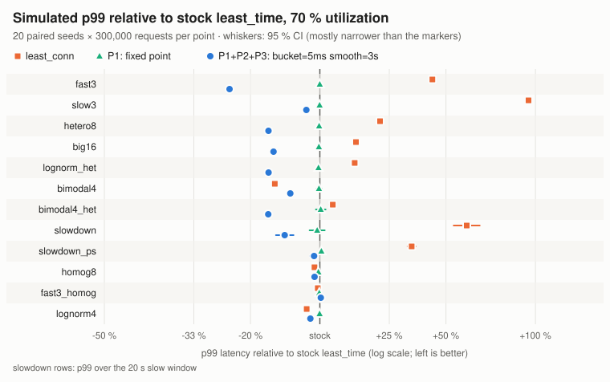
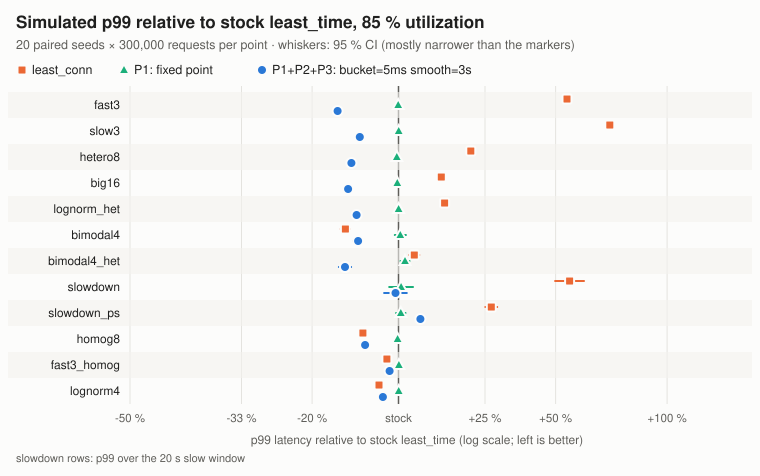

# Simulation results for the least_time patches

Discrete-event simulation (`sim/lbsim.py`), 20 paired seeds × 300,000 requests per cell, Poisson arrivals, first 20 % discarded. One nginx worker (shared state). Backends are FCFS single-server queues unless noted. `LeastTimePatch` mirrors the patched C integer arithmetic (1/64 ms fixed point, smoothing weight `min(1, max(0.01, elapsed/smooth))`).

Ratios are geometric means over seeds of p99(variant)/p99(stock least_time) on the same arrivals and costs, with 95 % t-intervals. Negative is better. For the slowdown scenarios, p99 is measured over the 20 s slow window.

## Scenarios

| name | setup |
| --- | --- |
| fast3 | 3 backends, 2/6/15 ms mean |
| slow3 | 3 backends, 20/60/150 ms mean |
| hetero8 | 8 backends, speeds 2,2,1,1,1,1,½,½; exp 10 ms |
| big16 | 16 backends, speeds U(½,2); exp 10 ms |
| lognorm_het | 8 backends as hetero8; lognormal(5 ms, σ=1) |
| bimodal4 | 4 equal backends; 90 % 2 ms / 10 % 80 ms |
| bimodal4_het | 4 backends, speeds 2,1,1,½; 90 % 2 ms / 10 % 80 ms |
| slowdown | 4 equal backends, one at ¼ speed for 20 s (FCFS) |
| slowdown_ps | as slowdown, processor-sharing backends |
| homog8 | 8 equal backends; exp 10 ms (control) |
| fast3_homog | 3 equal backends; exp 5 ms (control) |
| lognorm4 | 4 equal backends; lognormal(5 ms, σ=1) (control) |

## p99 change vs stock least_time

| scenario | util | least_conn | P1 | P1+P2 b5 | P1+P2+P3 b5 s3 | P1+P3 s3 |
| --- | --- | --- | --- | --- | --- | --- |
| fast3 | 0.5 | +26 % [+26, +27] | -1 % [-1, -0] | -42 % [-42, -42] | -46 % [-46, -46] | -11 % [-11, -11] |
| fast3 | 0.7 | +44 % [+43, +44] | -0 % [-0, +0] | -22 % [-22, -21] | -25 % [-26, -25] | -8 % [-8, -8] |
| fast3 | 0.85 | +54 % [+54, +55] | -0 % [-1, +0] | -9 % [-9, -9] | -15 % [-15, -14] | -4 % [-4, -3] |
| fast3 | 0.95 | +53 % [+51, +55] | +0 % [-0, +1] | -2 % [-3, -1] | -2 % [-3, -1] | +1 % [-0, +2] |
| slow3 | 0.5 | +127 % [+126, +128] | -0 % [-1, -0] | -5 % [-5, -5] | +4 % [+3, +4] | +7 % [+7, +8] |
| slow3 | 0.7 | +96 % [+94, +97] | -0 % [-0, +0] | -2 % [-3, -2] | -4 % [-5, -4] | -3 % [-4, -3] |
| slow3 | 0.85 | +73 % [+71, +74] | +0 % [-0, +1] | -1 % [-1, +0] | -10 % [-10, -9] | -9 % [-10, -9] |
| slow3 | 0.95 | +56 % [+54, +59] | +0 % [-0, +1] | -0 % [-1, +0] | -6 % [-7, -6] | -6 % [-7, -6] |
| hetero8 | 0.5 | +27 % [+27, +28] | -1 % [-1, -0] | -14 % [-14, -14] | -14 % [-15, -14] | +1 % [+0, +1] |
| hetero8 | 0.7 | +21 % [+21, +22] | -0 % [-1, +0] | -11 % [-11, -11] | -15 % [-15, -15] | -4 % [-4, -4] |
| hetero8 | 0.85 | +21 % [+20, +21] | -0 % [-1, -0] | -7 % [-7, -7] | -11 % [-12, -11] | -4 % [-4, -3] |
| hetero8 | 0.95 | +18 % [+17, +19] | -0 % [-1, +0] | -3 % [-4, -2] | -6 % [-6, -5] | -2 % [-3, -2] |
| big16 | 0.5 | +24 % [+23, +24] | -0 % [-0, +0] | -15 % [-15, -15] | -13 % [-14, -13] | +8 % [+8, +9] |
| big16 | 0.7 | +12 % [+12, +13] | -0 % [-1, -0] | -12 % [-13, -12] | -14 % [-14, -14] | -3 % [-3, -2] |
| big16 | 0.85 | +12 % [+11, +12] | -0 % [-1, -0] | -9 % [-9, -8] | -12 % [-13, -12] | -6 % [-6, -5] |
| big16 | 0.95 | +11 % [+10, +11] | -0 % [-1, +0] | -6 % [-6, -5] | -9 % [-10, -9] | -2 % [-3, -2] |
| lognorm_het | 0.5 | +15 % [+14, +15] | -1 % [-1, -0] | -11 % [-12, -10] | -15 % [-15, -14] | -1 % [-1, -0] |
| lognorm_het | 0.7 | +12 % [+11, +13] | -0 % [-1, +0] | -9 % [-10, -9] | -15 % [-16, -15] | -5 % [-5, -5] |
| lognorm_het | 0.85 | +13 % [+12, +13] | +0 % [-1, +1] | -5 % [-6, -5] | -10 % [-11, -9] | -5 % [-5, -4] |
| lognorm_het | 0.95 | +14 % [+13, +15] | -1 % [-1, +0] | -3 % [-4, -2] | -5 % [-6, -4] | -3 % [-4, -2] |
| bimodal4 | 0.5 | -14 % [-15, -14] | +0 % [-0, +1] | +8 % [+7, +9] | -9 % [-9, -8] | -9 % [-10, -9] |
| bimodal4 | 0.7 | -13 % [-14, -13] | -0 % [-1, +1] | +4 % [+3, +5] | -9 % [-10, -8] | -10 % [-11, -9] |
| bimodal4 | 0.85 | -13 % [-14, -12] | +0 % [-1, +2] | +2 % [+1, +4] | -10 % [-11, -9] | -10 % [-11, -8] |
| bimodal4 | 0.95 | -13 % [-14, -12] | +0 % [-1, +2] | +1 % [+0, +2] | -8 % [-9, -7] | -8 % [-10, -7] |
| bimodal4_het | 0.5 | +6 % [+6, +7] | -1 % [-2, -0] | +6 % [+5, +7] | -13 % [-13, -12] | -13 % [-14, -13] |
| bimodal4_het | 0.7 | +4 % [+3, +5] | +0 % [-1, +2] | +4 % [+3, +6] | -15 % [-16, -14] | -15 % [-16, -14] |
| bimodal4_het | 0.85 | +4 % [+3, +6] | +2 % [+1, +3] | +4 % [+2, +5] | -13 % [-14, -12] | -13 % [-14, -12] |
| bimodal4_het | 0.95 | +7 % [+5, +9] | +1 % [-1, +3] | +3 % [+1, +5] | -12 % [-13, -11] | -11 % [-12, -10] |
| slowdown | 0.5 | +80 % [+73, +86] | -2 % [-4, +0] | -5 % [-8, -3] | -6 % [-8, -3] | -5 % [-8, -3] |
| slowdown | 0.7 | +60 % [+54, +67] | -1 % [-3, +2] | -6 % [-9, -3] | -11 % [-13, -8] | -6 % [-8, -3] |
| slowdown | 0.85 | +55 % [+50, +61] | +1 % [-2, +4] | +3 % [-1, +6] | -1 % [-4, +2] | +1 % [-2, +4] |
| slowdown | 0.95 | +44 % [+39, +48] | -1 % [-4, +3] | -2 % [-6, +1] | +2 % [-1, +5] | +1 % [-2, +4] |
| slowdown_ps | 0.5 | +48 % [+45, +50] | +0 % [-1, +2] | -6 % [-7, -5] | -10 % [-11, -9] | -4 % [-5, -3] |
| slowdown_ps | 0.7 | +34 % [+33, +36] | +0 % [-0, +1] | -1 % [-2, -1] | -2 % [-3, -1] | -1 % [-2, -0] |
| slowdown_ps | 0.85 | +27 % [+25, +29] | +1 % [-1, +2] | +1 % [-1, +2] | +6 % [+5, +7] | +5 % [+4, +7] |
| slowdown_ps | 0.95 | +15 % [+14, +16] | +0 % [-1, +2] | +1 % [-0, +1] | +2 % [+2, +3] | +2 % [+2, +3] |
| homog8 | 0.5 | -0 % [-0, -0] | -0 % [-0, -0] | +1 % [+1, +1] | -0 % [-0, +0] | -0 % [-0, -0] |
| homog8 | 0.7 | -2 % [-2, -2] | -0 % [-1, -0] | -0 % [-0, +0] | -2 % [-2, -1] | -2 % [-2, -2] |
| homog8 | 0.85 | -9 % [-9, -9] | -0 % [-0, +0] | -7 % [-7, -7] | -8 % [-9, -8] | -2 % [-2, -2] |
| homog8 | 0.95 | -4 % [-4, -4] | +0 % [-0, +0] | -2 % [-3, -2] | -4 % [-4, -3] | -3 % [-3, -2] |
| fast3_homog | 0.5 | -0 % [-0, +0] | +0 % [-0, +0] | +2 % [+1, +2] | -0 % [-0, +0] | -0 % [-0, +0] |
| fast3_homog | 0.7 | -1 % [-1, -1] | -0 % [-0, -0] | +1 % [+1, +2] | +0 % [+0, +0] | -1 % [-1, -1] |
| fast3_homog | 0.85 | -3 % [-3, -3] | +0 % [-0, +1] | -1 % [-2, -1] | -2 % [-3, -2] | -2 % [-2, -1] |
| fast3_homog | 0.95 | -2 % [-2, -1] | -0 % [-1, +0] | -0 % [-1, +0] | -1 % [-2, -1] | -1 % [-1, -0] |
| lognorm4 | 0.5 | -2 % [-2, -2] | -1 % [-1, -0] | +3 % [+2, +3] | +0 % [-0, +0] | -0 % [-1, -0] |
| lognorm4 | 0.7 | -4 % [-4, -4] | -0 % [-0, +0] | -1 % [-1, -0] | -3 % [-3, -3] | -0 % [-1, +0] |
| lognorm4 | 0.85 | -5 % [-6, -4] | +0 % [-0, +1] | -2 % [-2, -1] | -4 % [-4, -4] | -2 % [-2, -1] |
| lognorm4 | 0.95 | -3 % [-4, -2] | +0 % [-0, +1] | +0 % [-0, +1] | -2 % [-3, -1] | -2 % [-3, -2] |

## P1+P2+P3 vs least_conn

Stock least_time loses to least_conn on mixed-cost traffic; this checks that the patched configuration does not.

| scenario | util 0.5 | util 0.7 | util 0.85 | util 0.95 |
| --- | --- | --- | --- | --- |
| fast3 | -57 % [-57, -57] | -48 % [-48, -48] | -45 % [-45, -44] | -36 % [-37, -35] |
| slow3 | -54 % [-54, -54] | -51 % [-51, -51] | -48 % [-48, -47] | -40 % [-41, -39] |
| hetero8 | -33 % [-33, -33] | -30 % [-30, -30] | -27 % [-27, -26] | -20 % [-21, -19] |
| big16 | -30 % [-30, -30] | -23 % [-23, -23] | -21 % [-22, -21] | -18 % [-19, -17] |
| lognorm_het | -26 % [-26, -25] | -24 % [-25, -24] | -20 % [-21, -20] | -17 % [-18, -16] |
| bimodal4 | +7 % [+6, +7] | +5 % [+4, +6] | +3 % [+2, +4] | +6 % [+5, +7] |
| bimodal4_het | -18 % [-18, -17] | -19 % [-19, -18] | -16 % [-18, -15] | -18 % [-19, -17] |
| slowdown | -47 % [-49, -46] | -44 % [-47, -41] | -36 % [-38, -34] | -29 % [-32, -26] |
| slowdown_ps | -39 % [-40, -38] | -27 % [-28, -26] | -17 % [-18, -16] | -11 % [-12, -10] |
| homog8 | +0 % [-0, +0] | +0 % [-0, +0] | +1 % [+0, +1] | +0 % [-0, +0] |
| fast3_homog | -0 % [-0, +0] | +1 % [+1, +1] | +1 % [+0, +1] | +0 % [+0, +1] |
| lognorm4 | +2 % [+2, +2] | +1 % [+1, +2] | +1 % [+1, +2] | +1 % [+0, +1] |

## Absolute p99 (ms, mean ± 95 % CI over seeds)

### fast3: 3 backends, 2/6/15 ms mean

| balancer | util 0.5 | util 0.7 | util 0.85 | util 0.95 |
| --- | --- | --- | --- | --- |
| round robin | 665528.6 ± 2076.2 | 893742.6 ± 2007.0 | 994425.7 ± 1979.6 | 1043884.2 ± 1966.9 |
| least_conn | 60.2 ± 0.3 | 81.3 ± 0.4 | 125.9 ± 1.1 | 282.9 ± 12.0 |
| least_time (stock) | 47.7 ± 0.2 | 56.6 ± 0.2 | 81.5 ± 0.8 | 185.6 ± 9.0 |
| P1: fixed point | 47.4 ± 0.1 | 56.6 ± 0.2 | 81.4 ± 0.9 | 186.1 ± 9.4 |
| P1+P2: bucket=5ms | 27.7 ± 0.1 | 44.3 ± 0.3 | 74.1 ± 0.7 | 181.8 ± 9.3 |
| P1+P2+P3: bucket=5ms smooth=3s | 25.8 ± 0.1 | 42.4 ± 0.3 | 69.6 ± 0.9 | 181.9 ± 10.3 |
| P1+P3: smooth=3s | 42.4 ± 0.2 | 52.1 ± 0.3 | 78.6 ± 0.7 | 186.9 ± 10.0 |

### slow3: 3 backends, 20/60/150 ms mean

| balancer | util 0.5 | util 0.7 | util 0.85 | util 0.95 |
| --- | --- | --- | --- | --- |
| round robin | 6655286.1 ± 20762.5 | 8937426.4 ± 20070.3 | 9944257.4 ± 19795.9 | 10438842.4 ± 19668.6 |
| least_conn | 601.9 ± 2.6 | 813.1 ± 4.3 | 1258.8 ± 11.3 | 2828.7 ± 120.0 |
| least_time (stock) | 265.2 ± 1.1 | 415.7 ± 3.2 | 729.7 ± 9.0 | 1813.9 ± 98.2 |
| P1: fixed point | 264.1 ± 0.9 | 415.4 ± 2.7 | 730.0 ± 8.6 | 1820.4 ± 89.8 |
| P1+P2: bucket=5ms | 252.3 ± 1.0 | 406.1 ± 2.4 | 726.0 ± 8.5 | 1809.6 ± 94.8 |
| P1+P2+P3: bucket=5ms smooth=3s | 275.0 ± 1.4 | 398.0 ± 3.0 | 660.3 ± 8.2 | 1697.8 ± 97.4 |
| P1+P3: smooth=3s | 284.4 ± 1.5 | 402.8 ± 3.2 | 662.4 ± 7.7 | 1701.1 ± 94.9 |

### hetero8: 8 backends, speeds 2,2,1,1,1,1,½,½; exp 10 ms

| balancer | util 0.5 | util 0.7 | util 0.85 | util 0.95 |
| --- | --- | --- | --- | --- |
| round robin | 80713.2 ± 1776.8 | 264754.0 ± 1713.7 | 346144.6 ± 1661.9 | 386124.0 ± 1651.6 |
| least_conn | 62.0 ± 0.2 | 72.1 ± 0.3 | 95.1 ± 0.6 | 180.0 ± 7.6 |
| least_time (stock) | 48.7 ± 0.1 | 59.5 ± 0.2 | 78.9 ± 0.6 | 152.4 ± 7.4 |
| P1: fixed point | 48.4 ± 0.2 | 59.3 ± 0.2 | 78.6 ± 0.6 | 151.9 ± 7.4 |
| P1+P2: bucket=5ms | 42.0 ± 0.1 | 52.9 ± 0.2 | 73.2 ± 0.6 | 147.8 ± 7.2 |
| P1+P2+P3: bucket=5ms smooth=3s | 41.7 ± 0.1 | 50.4 ± 0.2 | 69.9 ± 0.5 | 143.9 ± 7.8 |
| P1+P3: smooth=3s | 49.1 ± 0.1 | 56.9 ± 0.2 | 76.0 ± 0.6 | 149.0 ± 7.6 |

### big16: 16 backends, speeds U(½,2); exp 10 ms

| balancer | util 0.5 | util 0.7 | util 0.85 | util 0.95 |
| --- | --- | --- | --- | --- |
| round robin | 3051.3 ± 430.1 | 93934.3 ± 552.7 | 135790.3 ± 526.2 | 156436.9 ± 518.0 |
| least_conn | 56.2 ± 0.1 | 60.0 ± 0.2 | 72.0 ± 0.4 | 112.0 ± 3.5 |
| least_time (stock) | 45.3 ± 0.2 | 53.5 ± 0.1 | 64.5 ± 0.3 | 101.3 ± 3.2 |
| P1: fixed point | 45.3 ± 0.2 | 53.3 ± 0.2 | 64.3 ± 0.3 | 101.1 ± 3.2 |
| P1+P2: bucket=5ms | 38.5 ± 0.2 | 46.9 ± 0.1 | 59.0 ± 0.3 | 95.4 ± 3.4 |
| P1+P2+P3: bucket=5ms smooth=3s | 39.2 ± 0.2 | 46.1 ± 0.2 | 56.6 ± 0.3 | 92.0 ± 3.5 |
| P1+P3: smooth=3s | 49.0 ± 0.2 | 52.1 ± 0.2 | 60.9 ± 0.2 | 98.9 ± 3.4 |

### lognorm_het: 8 backends as hetero8; lognormal(5 ms, σ=1)

| balancer | util 0.5 | util 0.7 | util 0.85 | util 0.95 |
| --- | --- | --- | --- | --- |
| round robin | 67763.5 ± 1420.3 | 218791.4 ± 1564.5 | 285851.3 ± 1566.8 | 318824.8 ± 1539.7 |
| least_conn | 63.9 ± 0.3 | 76.5 ± 0.5 | 102.7 ± 1.2 | 198.9 ± 8.3 |
| least_time (stock) | 55.7 ± 0.4 | 68.4 ± 0.6 | 91.2 ± 1.4 | 174.6 ± 7.1 |
| P1: fixed point | 55.2 ± 0.4 | 68.1 ± 0.6 | 91.2 ± 1.4 | 173.4 ± 7.2 |
| P1+P2: bucket=5ms | 49.6 ± 0.4 | 62.0 ± 0.6 | 86.3 ± 1.3 | 169.7 ± 6.8 |
| P1+P2+P3: bucket=5ms smooth=3s | 47.6 ± 0.3 | 58.0 ± 0.5 | 81.9 ± 1.5 | 165.9 ± 7.5 |
| P1+P3: smooth=3s | 55.4 ± 0.3 | 64.9 ± 0.5 | 86.7 ± 1.3 | 169.2 ± 7.5 |

### bimodal4: 4 equal backends; 90 % 2 ms / 10 % 80 ms

| balancer | util 0.5 | util 0.7 | util 0.85 | util 0.95 |
| --- | --- | --- | --- | --- |
| round robin | 543.7 ± 9.2 | 942.7 ± 30.5 | 1915.1 ± 162.4 | 5236.3 ± 540.5 |
| least_conn | 272.9 ± 2.8 | 405.3 ± 7.2 | 672.1 ± 24.2 | 1506.3 ± 130.5 |
| least_time (stock) | 319.1 ± 3.6 | 468.5 ± 7.5 | 770.4 ± 23.9 | 1735.3 ± 147.3 |
| P1: fixed point | 319.5 ± 3.2 | 467.1 ± 7.4 | 774.2 ± 25.4 | 1744.1 ± 154.4 |
| P1+P2: bucket=5ms | 344.9 ± 3.7 | 485.5 ± 8.0 | 787.8 ± 26.0 | 1757.2 ± 148.3 |
| P1+P2+P3: bucket=5ms smooth=3s | 291.1 ± 2.4 | 426.0 ± 6.1 | 694.1 ± 22.5 | 1596.1 ± 139.6 |
| P1+P3: smooth=3s | 289.7 ± 2.7 | 423.1 ± 7.0 | 697.4 ± 24.9 | 1591.6 ± 136.8 |

### bimodal4_het: 4 backends, speeds 2,1,1,½; 90 % 2 ms / 10 % 80 ms

| balancer | util 0.5 | util 0.7 | util 0.85 | util 0.95 |
| --- | --- | --- | --- | --- |
| round robin | 157477.2 ± 7762.4 | 518113.2 ± 7931.9 | 677441.4 ± 7897.1 | 755716.6 ± 7871.0 |
| least_conn | 322.4 ± 3.3 | 497.5 ± 9.3 | 838.3 ± 25.9 | 1917.7 ± 149.0 |
| least_time (stock) | 303.7 ± 3.2 | 477.3 ± 8.7 | 805.0 ± 25.6 | 1791.1 ± 142.2 |
| P1: fixed point | 300.4 ± 2.8 | 478.7 ± 10.2 | 818.7 ± 28.6 | 1812.8 ± 146.4 |
| P1+P2: bucket=5ms | 320.9 ± 3.5 | 497.9 ± 8.7 | 835.1 ± 26.5 | 1846.7 ± 150.9 |
| P1+P2+P3: bucket=5ms smooth=3s | 264.4 ± 2.8 | 404.2 ± 6.8 | 701.7 ± 26.6 | 1573.2 ± 128.8 |
| P1+P3: smooth=3s | 262.9 ± 3.1 | 406.9 ± 7.8 | 698.4 ± 25.1 | 1591.6 ± 125.2 |

### slowdown: 4 equal backends, one at ¼ speed for 20 s (FCFS)

| balancer | util 0.5 | util 0.7 | util 0.85 | util 0.95 |
| --- | --- | --- | --- | --- |
| round robin | 9588.8 ± 210.1 | 12572.6 ± 150.3 | 13979.4 ± 127.8 | 14785.8 ± 135.3 |
| least_conn | 142.4 ± 3.6 | 243.3 ± 12.6 | 2534.2 ± 398.3 | 6737.4 ± 351.1 |
| least_time (stock) | 79.4 ± 3.1 | 151.9 ± 8.6 | 1631.4 ± 254.0 | 4684.3 ± 217.8 |
| P1: fixed point | 77.8 ± 2.8 | 150.4 ± 7.9 | 1640.2 ± 255.4 | 4662.1 ± 269.3 |
| P1+P2: bucket=5ms | 75.0 ± 2.3 | 142.6 ± 9.6 | 1679.0 ± 274.5 | 4593.8 ± 302.1 |
| P1+P2+P3: bucket=5ms smooth=3s | 74.8 ± 2.1 | 136.1 ± 9.3 | 1625.5 ± 260.3 | 4788.5 ± 273.0 |
| P1+P3: smooth=3s | 75.1 ± 2.5 | 143.8 ± 9.5 | 1656.0 ± 273.7 | 4744.8 ± 254.1 |

### slowdown_ps: as slowdown, processor-sharing backends

| balancer | util 0.5 | util 0.7 | util 0.85 | util 0.95 |
| --- | --- | --- | --- | --- |
| round robin | 18067.0 ± 199.0 | 26976.7 ± 296.7 | 37392.2 ± 446.3 | 47043.9 ± 530.0 |
| least_conn | 92.1 ± 1.0 | 118.4 ± 2.7 | 3523.6 ± 303.2 | 12246.3 ± 290.7 |
| least_time (stock) | 62.3 ± 0.7 | 88.1 ± 2.2 | 2777.0 ± 247.9 | 10650.9 ± 314.5 |
| P1: fixed point | 62.6 ± 0.7 | 88.6 ± 2.1 | 2796.3 ± 254.3 | 10699.1 ± 338.7 |
| P1+P2: bucket=5ms | 58.6 ± 0.8 | 87.0 ± 2.3 | 2793.9 ± 241.8 | 10710.2 ± 297.5 |
| P1+P2+P3: bucket=5ms smooth=3s | 55.9 ± 0.6 | 86.5 ± 2.3 | 2938.4 ± 261.5 | 10895.4 ± 308.0 |
| P1+P3: smooth=3s | 59.7 ± 0.8 | 86.8 ± 2.1 | 2927.9 ± 256.5 | 10908.2 ± 288.4 |

### homog8: 8 equal backends; exp 10 ms (control)

| balancer | util 0.5 | util 0.7 | util 0.85 | util 0.95 |
| --- | --- | --- | --- | --- |
| round robin | 61.8 ± 0.3 | 94.3 ± 0.9 | 179.0 ± 3.7 | 510.2 ± 25.8 |
| least_conn | 47.9 ± 0.1 | 54.5 ± 0.2 | 71.1 ± 0.5 | 143.8 ± 8.4 |
| least_time (stock) | 47.9 ± 0.1 | 55.5 ± 0.2 | 77.9 ± 0.5 | 149.6 ± 8.5 |
| P1: fixed point | 47.9 ± 0.1 | 55.2 ± 0.2 | 77.7 ± 0.5 | 149.6 ± 8.5 |
| P1+P2: bucket=5ms | 48.4 ± 0.1 | 55.4 ± 0.2 | 72.4 ± 0.5 | 146.4 ± 8.7 |
| P1+P2+P3: bucket=5ms smooth=3s | 47.9 ± 0.1 | 54.5 ± 0.2 | 71.5 ± 0.6 | 144.0 ± 8.5 |
| P1+P3: smooth=3s | 47.9 ± 0.1 | 54.5 ± 0.2 | 76.3 ± 0.6 | 145.7 ± 8.5 |

### fast3_homog: 3 equal backends; exp 5 ms (control)

| balancer | util 0.5 | util 0.7 | util 0.85 | util 0.95 |
| --- | --- | --- | --- | --- |
| round robin | 34.4 ± 0.2 | 54.2 ± 0.5 | 105.1 ± 3.1 | 312.5 ± 17.8 |
| least_conn | 28.1 ± 0.1 | 37.5 ± 0.2 | 61.9 ± 0.8 | 163.3 ± 12.4 |
| least_time (stock) | 28.1 ± 0.1 | 37.8 ± 0.3 | 63.8 ± 0.8 | 166.4 ± 12.5 |
| P1: fixed point | 28.1 ± 0.1 | 37.7 ± 0.3 | 63.9 ± 0.9 | 166.1 ± 12.5 |
| P1+P2: bucket=5ms | 28.6 ± 0.1 | 38.3 ± 0.2 | 63.1 ± 0.8 | 166.4 ± 13.0 |
| P1+P2+P3: bucket=5ms smooth=3s | 28.1 ± 0.1 | 37.9 ± 0.2 | 62.4 ± 0.8 | 164.0 ± 12.5 |
| P1+P3: smooth=3s | 28.1 ± 0.1 | 37.5 ± 0.2 | 62.7 ± 0.9 | 164.9 ± 12.4 |

### lognorm4: 4 equal backends; lognormal(5 ms, σ=1) (control)

| balancer | util 0.5 | util 0.7 | util 0.85 | util 0.95 |
| --- | --- | --- | --- | --- |
| round robin | 104.5 ± 1.4 | 165.1 ± 3.3 | 290.4 ± 8.4 | 726.5 ± 36.6 |
| least_conn | 62.3 ± 0.4 | 81.4 ± 0.8 | 124.8 ± 3.2 | 289.7 ± 16.5 |
| least_time (stock) | 63.5 ± 0.5 | 84.9 ± 0.9 | 131.2 ± 3.0 | 298.0 ± 16.3 |
| P1: fixed point | 63.1 ± 0.4 | 84.9 ± 1.0 | 131.3 ± 2.7 | 298.9 ± 16.6 |
| P1+P2: bucket=5ms | 65.3 ± 0.5 | 84.4 ± 1.0 | 129.0 ± 3.1 | 298.5 ± 16.7 |
| P1+P2+P3: bucket=5ms smooth=3s | 63.5 ± 0.5 | 82.4 ± 0.9 | 126.0 ± 2.9 | 291.7 ± 16.5 |
| P1+P3: smooth=3s | 63.2 ± 0.4 | 84.6 ± 1.0 | 128.9 ± 2.9 | 291.0 ± 16.3 |

## Parameter sweep: bucket × smooth (p99 vs stock)

Geometric mean over the sweep scenarios of the paired p99 ratio vs stock, and the worst scenario. Scenarios: fast3@0.7, slow3@0.7, hetero8@0.85, lognorm_het@0.7, bimodal4@0.7, bimodal4_het@0.7, slowdown@0.7, homog8@0.85.

| bucket | smooth | mean change | worst scenario |
| --- | --- | --- | --- |
| 1 ms | off | -6.8 % | bimodal4 +7 % |
| 1 ms | 1 s | -9.3 % | slow3 +19 % |
| 1 ms | 3 s | -14.1 % | slow3 -4 % |
| 1 ms | 10 s | -14.2 % | slowdown -7 % |
| 2 ms | off | -6.5 % | bimodal4 +7 % |
| 2 ms | 1 s | -9.1 % | slow3 +20 % |
| 2 ms | 3 s | -14.0 % | slow3 -4 % |
| 2 ms | 10 s | -13.8 % | slowdown -7 % |
| 5 ms | off | -5.6 % | bimodal4 +5 % |
| 5 ms | 1 s | -8.3 % | slow3 +17 % |
| 5 ms | 3 s | -12.3 % | slow3 -4 % |
| 5 ms | 10 s | -12.4 % | slowdown -7 % |
| 10 ms | off | -4.0 % | bimodal4_het +3 % |
| 10 ms | 1 s | -7.5 % | slow3 +17 % |
| 10 ms | 3 s | -11.4 % | slow3 -4 % |
| 10 ms | 10 s | -10.5 % | hetero8 -5 % |
| 20 ms | off | +0.2 % | slowdown +1 % |
| 20 ms | 1 s | -3.4 % | slow3 +16 % |
| 20 ms | 3 s | -6.2 % | homog8 -2 % |
| 20 ms | 10 s | -5.9 % | slowdown +1 % |
